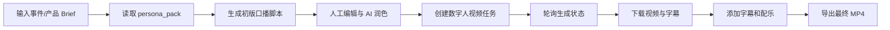

# Avatar AI Agent

一个面向内容生产场景的 AI 数字人视频工作流。用户输入事件、产品或品牌 Brief，系统结合可配置的人设画像生成口播脚本，支持人工修改与 AI 继续润色，再调用数字人视频服务生成视频，最后自动完成字幕、配乐和本地交付。

这是一个工作之余持续维护的独立个人项目，重点探索如何把大模型、数字人 API 和视频后处理能力组织成一条可交互、可编辑、可交付的内容生产流程。

## 项目亮点

- **从输入到交付的完整链路**：覆盖 Brief 输入、人设解析、脚本生成、人工编辑、视频生成、状态查询、字幕配乐和 MP4 导出。
- **人设驱动的内容生成**：通过 `persona_pack` 保存角色定位、表达风格和内容约束，使脚本生成具有稳定的人设上下文。
- **可替换的视频服务层**：通过 `VideoProvider` 抽象数字人视频服务，支持 Relay、HeyGen，并保留实验性的 Chanjing Provider。
- **人机协同编辑**：AI 先生成脚本，用户可以修改主题、长度、语气和表达重点，再通过 AI 进行二次润色。
- **异步任务与失败处理**：视频生成采用创建任务、轮询状态、拉取结果的异步流程，并向界面返回生成状态和失败原因。
- **视频后处理**：优先使用服务商字幕时间轴，其次使用 faster-whisper 生成时间轴，最后提供均匀时间轴作为兜底方案，并支持背景音乐合成。
- **本地可交付**：提供环境模板、健康检查、启动脚本和部署说明，便于在本地完成从配置到视频导出的验证。

## 产品流程



## 典型使用场景

- 将品牌或产品 Brief 快速转化为短视频口播初稿；
- 为同一主题生成符合不同人设和表达风格的内容；
- 在视频生成前进行人工编辑，控制观点、长度和语气；
- 将数字人视频、字幕和背景音乐串成一次性本地交付流程；
- 作为营销内容、知识分享和活动传播场景的 AI 原型验证工具。

## 功能模块

### 1. 人设驱动的脚本生成

用户输入事件、产品或品牌信息，系统读取本地 `persona_pack`，生成符合角色定位、受众和表达风格的中文口播稿。

### 2. 脚本编辑与二次润色

用户可以直接编辑初稿，也可以输入自然语言要求进行调整，例如：

- 改得更口语化；
- 压缩到 45 秒以内；
- 突出产品卖点；
- 减少技术术语；
- 让观点更鲜明；
- 调整为指定人设的表达方式。

### 3. 数字人视频生成

系统将确认后的脚本提交给视频服务商，创建异步生成任务，并通过轮询接口持续获取状态。视频服务通过 Provider 抽象接入，避免页面逻辑与具体服务商强耦合。

### 4. 字幕、配乐与本地交付

视频生成完成后，系统下载视频和字幕时间轴，使用 ffmpeg 完成字幕烧录与背景音乐合成，最后导出可下载的 MP4 文件。

## 技术架构

```text
Next.js UI
├── EventInput              输入事件/产品 Brief
├── ScriptEditor            脚本编辑与 AI 润色
├── VideoJobStatus          视频任务状态与错误展示
└── PostProcessPanel        字幕、配乐和导出

API Routes
├── /api/script             初版脚本生成
├── /api/script/refine      脚本二次润色
├── /api/videos              创建视频任务
├── /api/videos/[videoId]   查询视频任务状态
├── /api/postprocess         执行字幕与配乐后处理
└── /api/app-health          检查本地配置状态

Domain Modules
├── persona/                人设文件加载与校验
├── llm/                    OpenAI-compatible LLM Provider
├── video-provider/         视频服务商统一接口
├── relay/                  Relay 服务客户端
├── heygen/                 HeyGen 客户端与 Schema
├── script/                 Prompt、Schema 与文本清洗
└── postprocess/            ffmpeg、字幕、Whisper 与任务记录
```

## 关键设计

### 人设上下文与内容约束

`persona_pack.md` 用于保存较完整的人设分析和表达风格，`persona_pack.json` 用于保存角色名称、定位、语气和目标时长等结构化配置。脚本生成和润色都基于同一份人设上下文，减少多次生成中的风格漂移。

### Provider 抽象

视频生成通过 `VideoProvider` 定义统一的创建任务、查询状态和获取结果接口。Relay 适合本地或生产式接入，将密钥和网络处理放在独立服务中；HeyGen Provider 用于直接 API 调试；Chanjing Provider 保留用于实验对比。

### 可观测的异步任务

视频生成不是同步返回文件，而是先创建任务，再轮询状态。系统保留任务状态、视频地址、失败信息和字幕来源，便于用户知道流程停在哪一步，也便于后续定位接口或后处理问题。

### 字幕生成的多级兜底

字幕时间轴按以下顺序选择：

1. 服务商提供的原生字幕时间轴；
2. faster-whisper 生成的语音时间轴；
3. 均匀时间轴兜底方案。

## 技术栈

- Next.js 14
- React 18
- TypeScript
- OpenAI Node SDK 与 OpenAI-compatible API
- Zod
- HeyGen / Relay / Chanjing Provider
- ffmpeg / ffprobe
- faster-whisper（可选）
- PowerShell 与 Windows 启动脚本

## 本地运行

### 1. 安装依赖

```bash
npm install
```

### 2. 创建环境变量

```bash
copy .env.example .env.local
```

最小配置示例：

```env
LLM_API_KEY=your_llm_api_key
LLM_BASE_URL=https://api.deepseek.com/v1
LLM_MODEL=deepseek-v4-pro
LLM_THINKING_MODE=disabled

VIDEO_PROVIDER=relay
RELAY_BASE_URL=http://localhost:8787
RELAY_APP_KEY=dev_key
```

如果使用直连 HeyGen 模式，请按 `.env.example` 配置对应变量。任何真实 API Key 只能保存在本地环境文件中，不能提交到仓库。

### 3. 启动应用

```bash
npm run dev
```

打开 `http://localhost:3000` 即可进入本地应用。

## 项目结构

```text
src/
├── app/api/                 API 路由：脚本、视频、后处理和健康检查
├── components/              输入、脚本编辑、任务状态和后处理界面
└── lib/
    ├── llm/                 LLM Provider
    ├── persona/             人设加载与 Schema
    ├── script/              Prompt、Schema 和文本清洗
    ├── video-provider/      视频 Provider 抽象
    ├── relay/               Relay 客户端
    ├── heygen/              HeyGen 客户端
    ├── chanjing/            Chanjing 实验 Provider
    └── postprocess/         视频下载、字幕、Whisper 和 ffmpeg 后处理

data/persona/                脱敏的人设示例
prompts/                     脚本生成与润色 Prompt
docs/                        接口、部署和交付说明
scripts/                     本地启动与字幕辅助脚本
```

## 当前边界

这是一个可运行的本地 AI 应用原型，视频生成和 LLM 能力依赖外部服务商 API。仓库提供了完整的本地流程和 Provider 接口，但没有把它包装成面向多用户的托管 SaaS，也不包含真实客户资料、真实人设文档、生成视频或第三方密钥。

## 安全与隐私

以下内容不应提交到仓库：

- `.env.local` 或任何真实 API Key；
- 真实客户资料、人设文档和社交媒体原始数据；
- 真实头像、测试照片、背景音乐和生成视频；
- `data/postprocess/`、`data/chanjing/` 等运行时目录。

这些路径已在 `.gitignore` 中排除。使用第三方数字人服务时，也应确认输入图片、声音和生成内容符合对应服务商的授权与隐私要求。

## License

本仓库当前主要用于个人项目展示和技术验证。若需要将其中的代码或模块用于其他项目，请先确认第三方 SDK、模型服务和媒体素材的授权范围。
